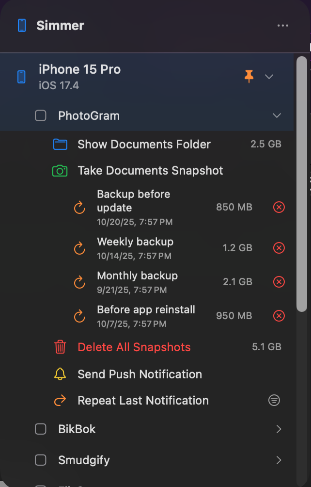

# Simmer

A macOS menubar app for iOS Simulator management. Quickly browse simulators, inspect installed apps, open Documents folders, and snapshot/restore app data. Version 2.0 adds a local MCP server so an agent can do the same.

<p align="center">
  
</p>

## Features

- **Simulator overview**
  - Recently used simulators with name, iOS version, and device icon
  - Pin/unpin for quick access

- **Installed apps per simulator**
  - App list with icons and names
  - Automatic refresh and path revalidation when apps are reinstalled

- **Documents folder tools**
  - Open an app's Documents directory in Finder
  - Live size readout for Documents

- **Snapshots for app data**
  - Take, restore, rename, and delete snapshots of Documents
  - Restore validation, retry logic, and progress feedback
  - Delete all snapshots with total size shown

- **Push notification helpers**
  - Compose and send test notifications to a selected simulator
  - Repeat last notification; pick from saved history

- **In-app updates**
  - Sparkle integration for update checks from the menu

- **MCP for agents**
  - Create and restore Documents snapshots
  - Send a push notification to a booted simulator
  - Loopback server while Simmer is running, or a stdio server via `--mcp`

## MCP

Simmer 2.0 speaks the [Model Context Protocol](https://modelcontextprotocol.io). The menu app listens on `http://127.0.0.1:8787/mcp` and accepts connections from this machine only.

Add this to Cursor's MCP settings (or `.cursor/mcp.json`) while Simmer is running:

```json
{
  "mcpServers": {
    "simmer": {
      "url": "http://127.0.0.1:8787/mcp"
    }
  }
}
```

The menu's **Copy MCP Config** copies that snippet when the server is up. If Simmer is not already open, Cursor can launch the binary itself:

```json
{
  "mcpServers": {
    "simmer": {
      "command": "/Applications/Simmer.app/Contents/MacOS/Simmer",
      "args": ["--mcp"]
    }
  }
}
```

Tools:

| Tool | What it does |
| --- | --- |
| `list_simulators` | Simulators that have apps installed |
| `list_apps` | Apps on one simulator |
| `list_snapshots` | Documents snapshots for an app |
| `create_snapshot` | Copy Documents into a new snapshot |
| `restore_snapshot` | Quit the app and replace Documents with a snapshot |
| `send_push_notification` | Deliver an APNs payload with `simctl push` |

`restore_snapshot` removes the current Documents folder after the copied files match the snapshot. `send_push_notification` requires a booted simulator. Pass a UDID and bundle id, or a simulator and app name when that name is unique.

## Download

Get the latest release from the GitHub Releases page.

- Releases: [`sdenowh/simmer · Releases`](https://github.com/sdenowh/simmer/releases)

## Build

- Xcode 15+ on macOS 14+
- Open `Simmer.xcodeproj` and run, or execute `./Simmer/build.sh`

## License

MIT — see [`LICENSE`](LICENSE). © 2025 Scott Denowh

## About

- Repository: [`github.com/sdenowh/simmer`](https://github.com/sdenowh/simmer)
- Issues & feedback: open an issue on the repo
